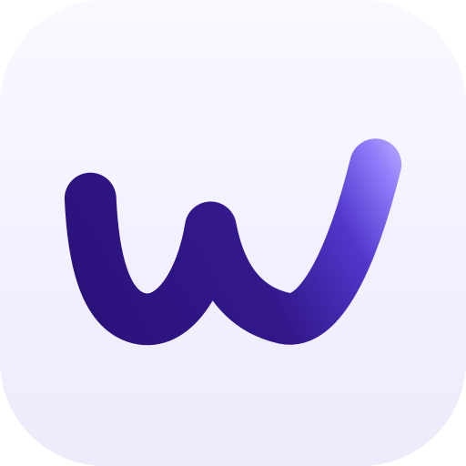

<p align="center">
   
</p>

<h1 align="center">WZML-X</h1>

<p align="center">
   Telegram mirroring and leeching platform with a container-based runtime, a lightweight web UI, and a configurable transfer pipeline.
</p>

<p align="center">
   <a href="https://github.com/SilentDemonSD/WZML-X">
      
   </a>

   <a href="https://github.com/SilentDemonSD/WZML-X/search?l=python">
      
   </a>

   <a href="https://github.com/SilentDemonSD/WZML-X/blob/main/docker-compose.yml">
      
   </a>

   <a href="https://t.me/WZML_X">
      
   </a>

   <a href="https://github.com/SilentDemonSD/WZML-X/blob/main/LICENSE">
      
   </a>

   <a href="https://github.com/SilentDemonSD/WZML-X/commits/main">
      
   </a>
</p>

## Index

<details open>
   <summary>Table of Contents <kbd>Click Here</kbd></summary>

   - [At a Glance](#at-a-glance)
   - [Why Use It](#why-use-it)
   - [What It Covers](#what-it-covers)
   - [How It Runs](#how-it-runs)
   - [VPS Setup and Operations](#vps-setup-and-operations)
   - [Alternative Deployment Examples](#alternative-deployment-examples)
   - [Configuration](#configuration)
   - [Project Layout](#project-layout)
   - [Documentation](#documentation)
   - [Support](#support)
   - [Credits](#credits)
   - [License](#license)
</details>

## At a Glance

| Area | Details |
|---|---|
| Runtime | Python Telegram bot + web UI |
| Deployment | Docker & Docker Compose (buildx) |
| Required config | `BOT_TOKEN`, `TELEGRAM_API`, `TELEGRAM_HASH`, `OWNER_ID`, `DATABASE_URL` |
| License | [LICENSE](LICENSE) |

## Why Use It

WZML-X is built for users who want a single bot stack that can mirror, leech, manage files, and expose a simple web-based selection flow without stitching together multiple tools. The README focuses on what you need to deploy it quickly, understand the moving parts, and tune the behavior safely.

## What It Covers

| Capability | Outcome |
|---|---|
| Mirroring | Send files to Telegram with a controllable pipeline |
| Leeching | Deliver files in the format you prefer, including document and media workflows |
| File selection UI | Review and select torrent / NZB / upload contents before finalizing |
| Multi-source downloads | Use qBittorrent, Aria2, JDownloader, Mega, NZB, and yt-dlp integrations |
| Storage and upload paths | Push content to Google Drive, Rclone, Mega, and other supported routes |
| Automation | Limit tasks, tune queues, and manage startup updates from one config layer |

## How It Runs

Deploy with Docker and provide the required configuration values. The container takes care of the runtime path, so users only need to build or start the image and set their settings.

<details>
   <summary>What you need <kbd>Click Here</kbd></summary>

   - Docker installed
   - Your Telegram bot token and Telegram API credentials
   - A MongoDB connection string
   - The optional service credentials you want to enable, such as Drive, Rclone, Mega, JDownloader, or SABnzbd
</details>

## VPS Setup and Operations

> Setup guide version: **1.1** (updated 11 October 2026). This guide describes the Docker deployment used by this WZML-X checkout. The live deployment includes local changes and a `docker-compose.override.yml`; use the matching source snapshot and overlay when setting up another VPS. An upstream clone alone may not contain those deployment changes.

### 1. Prepare the VPS and source tree

Use a supported 64-bit Ubuntu VPS with enough disk space for temporary downloads. Install Git, Docker Engine, and the Docker Compose plugin using the [official Docker Ubuntu installation guide](https://docs.docker.com/engine/install/ubuntu/). Confirm the CLI is available:

```bash
docker --version
docker compose version
git --version
```

Place the complete WZML-X deployment source in a stable directory. This VPS uses:

```bash
cd /root/ensembly/leaf/WZML-X
```

For another VPS, use its own checkout path consistently. Preserve deployment-specific files such as `docker-compose.override.yml`; this overlay enables the live config file, NZB support, and MongoDB keepalive service. If you copy the overlay to another directory, update any absolute host paths in its volume mounts to match that checkout.

Before changing or updating an existing checkout, inspect its local changes and keep a backup of configuration and state. Do not use `git reset --hard` to update a live installation.

### 2. Create private configuration

The bot uses two configuration files:

- `config.py` contains the main bot configuration. Start from `config_sample.py`.
- `config.env` contains Prowlarr credentials/runtime values and supported Seedr overrides. Start from `config.env.example`. It is not a replacement for `config.py`.

Create the files and data directories:

```bash
cp -n config_sample.py config.py
cp -n config.env.example config.env
mkdir -p accounts downloads configs/prowlarr qBittorrent/config
chmod 600 config.py config.env
chmod 700 accounts downloads
```

Edit `config.py` and set at least:

| Setting | Purpose |
|---|---|
| `BOT_TOKEN` | Token for the Telegram bot created with BotFather |
| `OWNER_ID` | Numeric Telegram user ID with owner access |
| `TELEGRAM_API` and `TELEGRAM_HASH` | Telegram application credentials from `my.telegram.org` |
| `DATABASE_URL` | MongoDB connection URI used for bot data and the keepalive service |

Set optional values in the same file as needed, including `USER_SESSION_STRING`, `GDRIVE_ID`, upload settings, logging chats, queue limits, and `USENET_SERVERS`. Use `config_sample.py` as the complete setting reference. Never put real credentials in the README or commit `config.py`, `config.env`, session strings, tokens, or service-account files.

If you use Google Drive, create or copy a valid `token.pickle` using the instructions in `gen_scripts/gen_token_pickle/README.md`. Keep it beside the Compose files. Do not create an empty placeholder. The deployment overlay mounts this file into the app container.

For Usenet, configure a server entry under `USENET_SERVERS` in `config.py`. Use the provider's NNTP host, SSL port (commonly 563), username, password, and allowed connection count. Keep the provider credentials private. SABnzbd is started by the bot inside the app container; it is not a separate Compose service.

### 3. Configure Prowlarr and the deployment overlay

In `config.env`, set a strong local Prowlarr username and password. Replace `SERVER_PUBLIC_IP` in `PROWLARR__HOST__ALLOWEDHOSTS` with this VPS's public IP, keeping the local Docker hostnames in the list. Leave `PROWLARR_API_KEY` blank: on startup, Prowlarr generates the key and `scripts/provision_prowlarr.py` configures authentication and syncs the key into `config.env` and the bot's saved settings.

The Compose overlay must be present beside `docker-compose.yml`. For a new checkout, use the overlay shipped with the deployment bundle and adjust its host paths, or create the equivalent settings below. The current overlay must:

- mount `config.env` into the app container;
- set `DISABLE_NZB` to `false`;
- run `scripts/start_bot.sh` before `python -m bot` so Prowlarr is provisioned;
- start the `keepalive.py` service with access to `config.py`;
- preserve the mounts for `config.py`, `accounts`, `downloads`, `token.pickle`, qBittorrent config, and Prowlarr config.

A portable overlay matching the live services can be created as `docker-compose.override.yml` beside `docker-compose.yml`. Keep paths relative to the checkout. If Google Drive is not configured yet, omit the `token.pickle` mount until a valid token file exists.

```yaml
services:
  app:
    image: wzmlx-v3-live
    build: .
    environment:
      DISABLE_NZB: "false"
    entrypoint: ["bash", "scripts/start_bot.sh"]
    command: ["python", "-m", "bot"]
    restart: unless-stopped
    ports:
      - "8081:8081"
      - "8082:8082"
    volumes:
      - ./config.py:/usr/src/app/config.py:ro
      - ./config.env:/usr/src/app/config.env
      - ./accounts:/usr/src/app/accounts
      - ./downloads:/usr/src/app/downloads
      - ./token.pickle:/usr/src/app/token.pickle
      - ./qBittorrent/config:/usr/src/app/qBittorrent/config
      - ./qBittorrent/config:/usr/src/app/configs/qbittorrent
      - ./configs/prowlarr:/usr/src/app/configs/prowlarr:ro

  keepalive:
    image: wzmlx-v3-live
    build: .
    entrypoint: ["python"]
    command: ["keepalive.py"]
    restart: unless-stopped
    volumes:
      - ./config.py:/usr/src/app/config.py:ro
```

The Prowlarr web port is bound to `127.0.0.1:9696`, not the public interface. To open it from your computer, create an SSH tunnel:

```bash
ssh -N -L 9696:127.0.0.1:9696 root@YOUR_VPS_IP
```

Then open `http://127.0.0.1:9696` locally. Sign in with the credentials from `config.env`, add the NZBIndex indexer, and run its **Test** action. Do not expose port 9696 publicly. The bot reaches Prowlarr over the Compose network at `http://prowlarr:9696`.

### 4. Validate and start the stack

From the repository directory, validate the merged Compose configuration and check that the deployment-specific services are present:

```bash
docker compose config --quiet
docker compose config --services
```

The live configuration should include `app`, `prowlarr`, `keepalive`, and `tunnel`. Then build and start the stack:

```bash
docker compose up -d --build
docker compose ps
```

The app provisions Prowlarr at startup, starts the Telegram bot, and launches its transfer services. The keepalive service writes one small heartbeat daily to the `wzmlx.service_keepalive` MongoDB collection. It does not modify bot-owned collections or user data. Compose restart policies bring the services back after a VPS reboot.

### 5. Finish Telegram and integration setup

1. Start a private chat with the bot and send `/start`.
2. Add the bot to each group where it should respond. For a leech dump/log group, promote the bot with **Manage Chat** and **Delete Messages** permissions.
3. If `USER_SESSION_STRING` is configured and user-mode leeching is enabled, add that user account to the Leech Dump chat and grant it the same permissions. The bot reports a specific setup error if that session account is not an admin or lacks either permission.
4. Set the intended `LEECH_LOG_CHAT` and other chat IDs in `config.py`. `LEECH_DUMP_CHAT` is deprecated; use `LEECH_LOG_CHAT`.
5. If using Usenet, confirm the server settings in `USENET_SERVERS`, then use `/nzs <search terms>` in Telegram. Search results come from the configured Prowlarr indexers; selecting a result queues the NZB mirror flow.
6. If using Seedr, configure the supported Seedr API token and options in `/bsetting` or the supported `SEEDR_*` entries in `config.env`. The env-file loader accepts the API token and behavior/timeout options; legacy email/password entries in `config.env` are not loaded by it.
7. Test routine commands such as `/health`, `/stats`, `/status`, and the integrations you enabled.

### 6. Start, stop, inspect, and update

```bash
# List service state
docker compose ps

# Follow all logs, or only one service
docker compose logs -f
docker compose logs -f app

# View recent logs without following
docker compose logs --tail=200 app

# Stop services but retain containers and data
docker compose stop

# Start previously stopped services
docker compose start
```

To rebuild and recreate only the bot app after code changes, first confirm no active downloads or uploads will be interrupted:

```bash
docker compose build app
docker compose up -d --no-deps app
```

Use `docker compose restart app` only when the image does not need rebuilding. Compose logs can contain credentials or private links; redact them before sharing.

Avoid `docker compose down -v`, `docker volume prune`, and broad Docker cleanup commands on a live installation. The `-v` option removes named volumes such as the tunnel data volume. A normal `docker compose down` removes containers and the network but keeps named volumes and bind-mounted files.

### 7. Back up and restore

Keep a private backup of the deployment source revision and the files that hold configuration or persistent local state:

- `config.py` and `config.env`;
- `accounts/` and `token.pickle`;
- `qBittorrent/config/` and `configs/prowlarr/`;
- any custom Compose overlay and the relevant Docker named-volume data if you need the same tunnel state.

The MongoDB database stores bot settings and user data; keep its URI private and use the database provider's backup/restore options. `downloads/` is temporary task/cache data and may be large, so include it only when unfinished downloads must be preserved. Test restoration on a separate directory or VPS before replacing a live deployment.

### 8. Troubleshooting checklist

- **App exits:** inspect `docker compose logs --tail=200 app`; verify the required `config.py` settings and MongoDB reachability.
- **Prowlarr is unreachable from the app:** keep `PROWLARR_URL=http://prowlarr:9696`; `localhost` inside the app container points back to the app container, not Prowlarr.
- **Prowlarr rejects the browser request:** update `PROWLARR__HOST__ALLOWEDHOSTS` with the connecting host/IP and recreate Prowlarr if its environment needs reloading.
- **`/nzs` reports NZB disabled:** confirm the overlay sets `DISABLE_NZB: "false"`, then recreate the app service.
- **Leech task says the session is not admin:** promote the user session account in the Leech Dump chat and grant Manage Chat and Delete Messages. If bot-mode leeching is used, grant the same permissions to the bot account.
- **MongoDB pauses or is unreachable:** verify `DATABASE_URL`, network access rules, and `docker compose logs --tail=100 keepalive`.
- **A transfer looks stuck:** inspect `/status` in Telegram and the relevant app logs before restarting. A restart can interrupt in-container download work.

## Alternative Deployment Examples

<details open>
   <summary>Upstream VPS / Dedicated Server Example</summary>

   ```bash
   git clone https://github.com/SilentDemonSD/WZML-X.git
   cd WZML-X
   cp config_sample.py config.py
   # Edit config.py with your values
   docker buildx compose up -d
   ```

   The bot runs behind a Cloudflare quick tunnel by default. Check the tunnel URL:

   ```bash
   docker compose logs tunnel
   ```

   You'll see a `https://*.trycloudflare.com` URL — that's your bot's web UI.

   To stop:

   ```bash
   docker buildx compose down
   ```
</details>

<details>
   <summary>VPS with VPN (Gluetun)</summary>

   1. Uncomment the `gluetun` service in `docker-compose.yml`
   2. Fill in your VPN provider credentials
   3. Set `network_mode: "service:gluetun"` on the `app` service
   4. Start:

   ```bash
   docker buildx compose up -d
   ```

   All traffic (including the cloudflared tunnel) routes through the VPN.
</details>

<details>
   <summary>Multi-Instance (Multiple Bots)</summary>

   Each bot needs its own `config.py` and data volumes. Example for a second bot:

   1. Create `config2.py` with different `BOT_TOKEN`, `OWNER_ID`, etc.
   2. Uncomment `app2` and `tunnel2` in `docker-compose.yml`
   3. Edit volume mounts to use `config2.py` and separate data dirs
   4. Start:

   ```bash
   docker buildx compose up -d
   ```

   Each bot gets its own cloudflared tunnel URL. Admin ports (qBittorrent, SABnzbd) are mapped to different host ports (`127.0.0.1:8091`, etc.).
</details>

<details>
   <summary>Single Container (Manual)</summary>

   ```bash
   git clone https://github.com/SilentDemonSD/WZML-X.git
   cd WZML-X
   docker build -t wzmlx .
   docker run -p 8080:8080 wzmlx
   ```
</details>

<details>
   <summary>Deployment Notes</summary>

   1. If you use qBittorrent, tune `AsyncIOThreadsCount` to your machine size.
   2. Stop the container before removing it, and remove the container before pruning images.
   3. Useful cleanup commands:

   ```bash
   docker container prune
   docker image prune -a
   ```
</details>

<details>
   <summary>Legacy Workflow Guide</summary>

   Some users still rely on the external workflow path referenced by the previous README:

   - [WZ Deploy workflow guide](https://github.com/SilentDemonSD/WZ-Deploy/tree/main?tab=readme-ov-file#2%EF%B8%8F%E2%83%A3-method-2-github-workflow-guide)

   Keep this only if that workflow still matches your deployment style.
</details>

## Configuration

The runtime reads the primary bot settings from `config.py`; `config.env` is a protected sidecar for Prowlarr and supported Seedr overrides, not a general replacement for `config.py`.

Start with the required values:

- `BOT_TOKEN`
- `TELEGRAM_API`
- `TELEGRAM_HASH`
- `OWNER_ID`
- `DATABASE_URL`

Then tune the optional behavior from `config_sample.py`. Keep the live `config.py` private and use the sample only as a reference.

<details>
   <summary>Important user-facing settings</summary>

   | Setting | User impact |
   |---|---|
   | `DEFAULT_LANG` | Bot language |
   | `STATUS_LIMIT` | How much status data is shown |
   | `DEFAULT_UPLOAD` | Default upload target |
   | `LEECH_SPLIT_SIZE` | How large leech outputs are split |
   | `QUEUE_ALL`, `QUEUE_DOWNLOAD`, `QUEUE_UPLOAD` | Queue pressure and concurrency |
   | `SHOW_CLOUD_LINK` | Whether cloud links are shown to users |
   | `WEB_PINCODE` | Protects web access to file selection |
</details>

<details>
   <summary>Integrations available in config</summary>

   The sample config also covers:

   - qBittorrent and Aria2-related controls
   - JDownloader login details
   - Mega credentials
   - SABnzbd server definitions
   - Google Drive settings
   - RSS, search, media metadata, and logging controls
</details>

<details>
   <summary>AllDebrid (<code>-ad</code>)</summary>

   Set `ALLDEBRID_API_KEY` (default: empty, feature off) in `config_sample.py`,
   in the environment, or from **Bot Settings → Config Variables → ALLDEBRID_API_KEY**.

   Add `-ad` to a mirror/leech command to route the input through AllDebrid:

   - `/mirror <filehost link> -ad` unlocks premium hosts (1fichier, rapidgator,
     mega, ...) and hands the direct link to the normal downloader.
   - `/leech <magnet> -ad` (or reply to a `.torrent` with `-ad`) uploads the
     torrent to AllDebrid, waits for it to finish there, then downloads every
     file from AllDebrid's CDN — aria2/qBittorrent are bypassed entirely.

   `ALLDEBRID_NO_SEED_TIMEOUT` (default: `180`) caps how many seconds a magnet may
   stall with no seeders and no download progress before the task is aborted.
   Set it to `0` to disable the check and rely on AllDebrid's own dead-torrent
   reporting instead.

   The flag is documented in the mirror help menu under the **AllDebrid** button.
   Without a key the task fails with `ALLDEBRID_API_KEY is not configured`;
   without `-ad` nothing changes. Magnets stop after 3 min with no seeders and
   2 h overall, and are removed from your AllDebrid history if the task fails.
</details>

## Project Layout

| Path | Purpose |
|---|---|
| `bot/` | Bot core, handlers, listeners, and modules |
| `web/` | FastAPI app, templates, and the file selector UI |
| `gen_scripts/` | Setup helpers for sessions, tokens, and drive configuration |
| `plugins/` | Optional bot plugins |
| `qBittorrent/` | Default qBittorrent configuration |
| `sabnzbd/` | Default SABnzbd configuration |

## Documentation

> [!NOTE]
> Setup and operations guide: v1.1, updated 11 October 2026. The reference sections below describe upstream/alternate options.

- Full guides: `docs/`
- Deployment notes: the docs site linked from the repository at WZ Docs
- Configuration reference: `config_sample.py`

## Support

<details>
   <summary>Join Community</summary>

   - Telegram channel: https://t.me/WZML_X
   - Support group: https://t.me/WZML_Support
</details>

## Credits

WZML-X is a fork of [mirror-leech-telegram-bot](https://github.com/anasty17/mirror-leech-telegram-bot). The base project belongs to [anasty17](https://github.com/anasty17) and upstream contributors.

<details>
   <summary>Bot Authors</summary>

   <table>
      <thead>
         <tr>
            <th>Avatar</th>
            <th>Name</th>
            <th>Role</th>
            <th>Profile</th>
         </tr>
      </thead>
      <tbody>
         <tr>
            <td></td>
            <td>SilentDemonSD</td>
            <td>Author, UI design, and custom features</td>
            <td><a href="https://github.com/SilentDemonSD">GitHub</a></td>
         </tr>
         <tr>
            <td></td>
            <td>RjRiajul</td>
            <td>Co-author and maintainer</td>
            <td><a href="https://github.com/rjriajul">GitHub</a></td>
         </tr>
         <tr>
            <td></td>
            <td>CodeWithWeeb</td>
            <td>Feature expansion and wrap-up improvements</td>
            <td><a href="https://github.com/weebzone">GitHub</a></td>
         </tr>
         <tr>
            <td></td>
            <td>Maverick</td>
            <td>Co-author and bug testing</td>
            <td><a href="https://github.com/MajnuRangeela">GitHub</a></td>
         </tr>
      </tbody>
   </table>
</details>

## License

This project is distributed under the terms of the repository license. See [LICENSE](LICENSE) for the full text.

